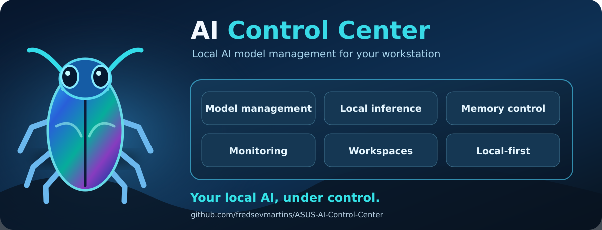

  

<h1 align="center">AI Control Center</h1>

<strong>Your local AI, under control.</strong>

A local-first desktop dashboard for managing installed AI models, monitoring workstation resources and browsing a read-only model library.

> **Project status:** Active development. The application interface and some filenames still use the historical name **ASUS AI Control Center**. This project is independently developed and is **not affiliated with or endorsed by ASUS**.
>
> **Security / release status:** The repository remains private. A public-release security review is not yet complete. The source does not currently include a verified top-level LICENSE file; do not assume a particular redistribution license from promotional artwork.

## Why this project exists

Running several local AI models is often fragmented: Ollama exposes one set of controls, SGLang another, and system memory, GPU use and NAS assets must be checked separately. Loading a large model without knowing the other workloads can disrupt active clients or exhaust unified memory.

**AI Control Center brings these observations and deliberate model actions into a single local interface**, without turning your workstation into a cloud-managed service.

| The problem | What AI Control Center provides |
| --- | --- |
| Different models use different runtimes | One view of registered Ollama and SGLang models |
| Loaded does not always mean ready to answer | Separate residency, process and inference-readiness evidence |
| Model switching can interrupt clients | Explicit preflight, selection, risk acknowledgement and confirmation |
| Unified memory is shared across CPU and GPU | Current memory, GPU/CPU gauges and a bounded memory history |
| Weight files on a NAS are difficult to navigate | Read-only inventory of collections, file sizes and structural evidence |
| Management scripts are inconvenient | A local application window and per-user launcher |

## Features

- **Overview:** live unified-memory, CPU and GPU instrumentation; current loaded-model count; memory timeline; runtime, storage and hardware summaries.
- **Model Manager:** installed/loaded/unknown states, search and filters, metadata with provenance, Details inspector, and deliberate load/unload/switch actions.
- **Model Library:** registered models plus **read-only** NAS asset discovery. A weight file is *not* automatically considered an executable model.
- **Workspaces:** informational presets for coding, scientific research, general AI, image, video and voice workflows. They do **not** automatically start models.
- **Activity:** bounded local operation-event history.
- **Settings:** appearance preferences and local connection information.
- **Themes and visuals:** Midnight Titanium / Frosted Titanium design, responsive layouts, accessible controls and instrument gauges.

The removed Performance view has been consolidated into Overview.

## Requirements

**Validated target:** Linux desktop on Ubuntu 24.04 ARM64 (ASUS GX10 / Grace Blackwell class hardware). Other Linux workstations may work but are not automatically qualified. Windows and macOS are not currently supported installation targets.

- Python 3.12-compatible system Python 3.
- Chromium or Firefox for the desktop UI. Chromium can open an app-style window; Firefox uses a normal browser window.
- Existing Ollama and/or SGLang installations **only if you want runtime discovery and management**. The dashboard does not install either runtime.
- Optional mounted NAS model directory for read-only browsing.
- A trusted, local Linux user account with the existing permissions for runtime inspection and lifecycle operations. Never grant blanket sudo or unrestricted Docker access to make the UI work.

The production backend uses the Python standard library and a vanilla HTML/CSS/JavaScript frontend. Node.js and Playwright are used **for development testing**, not normal operation.

## Installation (desktop, recommended)

The current tested UI is on the development branch; installing from that branch requires access to this repository.

~~~bash
git clone --branch dev/premium-control-center https://github.com/fredsevmartins/ASUS-AI-Control-Center.git
cd ASUS-AI-Control-Center
python3 desktop/install_desktop.py
~~~

Open **ASUS AI Control Center** from the applications menu or desktop shortcut. The launcher points to this checkout, so **do not move or delete the repository directory after installation**. It installs only user-level launchers and backs up matching existing shortcuts; it does not install a system daemon.

You can also launch directly:

~~~bash
python3 desktop_launcher.py
~~~

Chromium is preferred for the standalone application window. To request Firefox:

~~~bash
ASUS_AI_BROWSER=firefox python3 desktop_launcher.py
~~~

To stop the application-owned local backend:

~~~bash
python3 desktop_launcher.py --stop
~~~

Closing the window alone does **not** stop that backend. Do not use <code>sudo</code> for installation. Do not run legacy <code>install.sh</code> merely to test the development checkout: it installs a separate historical v5 copy.

**Alternative: browser-only development run**

~~~bash
AI_MANAGER_PORT=0 python3 server.py
~~~

This starts an authenticated server on a random <code>127.0.0.1</code> port, opening your browser. Keep the terminal open; stop with Ctrl+C.

More details: [Installation](docs/INSTALLATION.md) and [Desktop behavior](docs/design/DESKTOP-EXPERIENCE.md).

## Using the app

1. Open **Overview** to inspect current memory, runtimes and storage.
2. Open **Model Manager** to find a registered model and inspect **Details**.
3. Use **Load**, **Unload** or **Switch** only when you understand which workloads might be interrupted.
4. Review the preflight estimates, explicitly selected stops and confirmation dialog before any disruptive action.
5. Use **Model Library** to browse mounted NAS assets; the inventory is not a model installer.

See [User guide](docs/USER_GUIDE.md).

## Safety model and limitations

- The HTTP server binds to **loopback only** and requires a per-process session credential.
- Runtime discovery is limited to existing local endpoints. SGLang authentication is **not** disabled or bypassed.
- **Loaded ≠ inference ready.** An unsupported SGLang readiness endpoint leaves readiness **Unverified**.
- Memory requirements are estimates, not guarantees. The application cannot reliably detect all active clients.
- Model switching can disrupt running jobs. Recovery is best effort, not transactional.
- History and in-process operations do not survive an application-process restart.
- NAS discovery is read-only, and stored weights are not made runnable automatically.
- Never share authenticated launch URLs, allow LAN port forwarding, or deploy behind a public reverse proxy without a separate security design.

Read [Security](SECURITY.md), [Architecture](ARCHITECTURE.md), and [Public-release audit](docs/audits/PUBLIC_RELEASE_SECURITY_AUDIT.md).

## Testing and development

~~~bash
python3 -m unittest discover -s tests -v
node tests/test_frontend.js
node tests/test_model_manager.js
node tests/test_model_intelligence.js
npm ci
npm run visual:existing
AI_MANAGER_E2E_BROWSER=chromium node tests/browser_e2e.mjs
AI_MANAGER_E2E_BROWSER=firefox node tests/browser_e2e.mjs
~~~

Browser tests use explicit demo fixtures and may require locally installed Playwright browser binaries. **Never** run lifecycle tests against live models. See [TESTING.md](TESTING.md) and the [fidelity validation report](docs/design/FINAL_PROTOTYPE_FIDELITY_REPORT.md). Previously reported test counts are historical; run them again on the checked-out revision.

## Documentation

| Guide | Description |
| --- | --- |
| [Installation](docs/INSTALLATION.md) | Setup, launch options, desktop integration and troubleshooting |
| [User guide](docs/USER_GUIDE.md) | How to use the six sections safely |
| [Architecture](ARCHITECTURE.md) | Backend, runtimes and safety contracts |
| [Security](SECURITY.md) | Authentication, permissions and threat boundaries |
| [Testing](TESTING.md) | Unit, browser, demo and visual regression |
| [Design](DESIGN.md) | Themes, materials and component design |
| [Roadmap](ROADMAP.md) | Historical development and outstanding validation |
| [Brand assets](docs/BRANDING.md) | Jewel beetle identity and artwork notes |

## Contributors

Contributions should preserve local-only authentication, the existing runtime configuration and explicit user authorization for lifecycle changes. Read [AGENTS.md](AGENTS.md) before proposing changes.

**Project repository:** https://github.com/fredsevmartins/ASUS-AI-Control-Center

**Trademark note:** ASUS, NVIDIA, Ollama and SGLang are trademarks of their respective owners. Mentioning compatible hardware or software does not imply endorsement.
